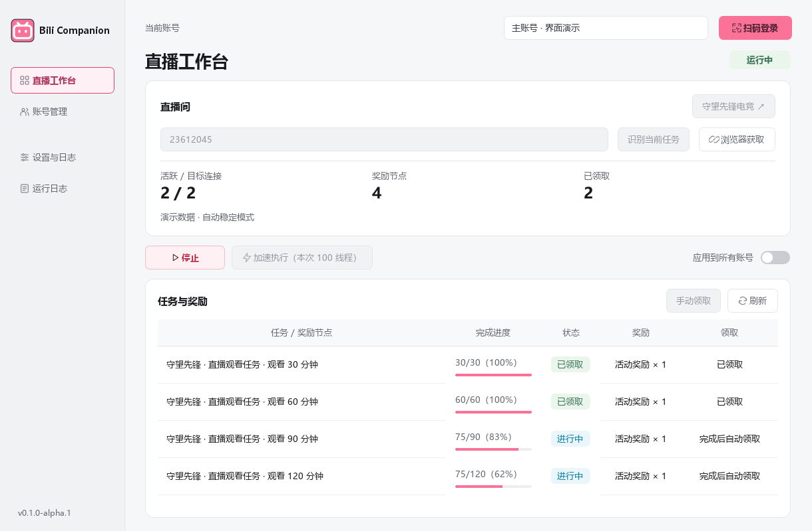

<div align="center">


# Bili Live Companion

### 哔哩哔哩直播掉宝自动挂机领取小助手

**你负责扫码，它负责守候。**


[](LICENSE)

扫码登录 · 多账号守候 · 任务进度 · 达标领奖

**v0.1.0** · [下载 Windows x64 版](https://github.com/BeamusWayne/bili-live-companion/releases/tag/v0.1.0) · [Windows 使用说明](docs/windows.md)

[功能一览](#功能一览) · [桌面界面](#桌面界面) · [快速开始](#快速开始) · [相关项目](#相关项目) · [支持项目](#支持项目) · [English](README_EN.md)

</div>

---

## 功能一览

| 能做什么 | 具体表现 |
| --- | --- |
| 📱 **扫码登录** | Windows / macOS 在应用内扫码；Linux 在 SSH 终端显示字符二维码和扫码地址 |
| 👥 **多账号运行** | 每个账号独立保存凭据、直播间和任务状态 |
| 📺 **观看心跳** | 按配置连接直播间，在断线后重试 |
| 🎯 **任务追踪** | 识别当前任务、查询奖励节点进度，并在达标后尝试自动领取 |
| 🔔 **完成通知** | 可配置 Telegram、Gotify、Server 酱和企业微信通知地址 |

任务与奖励结果以 Bilibili 实际接口为准。页面结构变化可能影响自动识别；此时仍可观看，并可在 Linux 配置中手动填写任务 ID。

## 与下载器联动（v0.1.1-beta.1）

侧栏新增「下载回放 / 视频」。粘贴已发布回放或相关视频的 BV/AV 链接，在 [BilibiliVideoDownloader](https://github.com/BeamusWayne/bilibili-video-downloader) 中确认格式、目录和分 P 后保存。两款应用独立保存凭据，仅传递公开链接；直播间不是回放地址。未安装下载器时可获取安装包或复制链接。

运行状态区区分连接心跳、平台最近同步和已确认的进度增长。连续三次成功同步没有增长时明确提示；活动截止时间可用时显示，超过同步时限则标明数据过期。未增长提示表示需要检查平台任务状态，不等于断言掉宝活动失效。

当前测试版安装包见 [Releases](https://github.com/BeamusWayne/bili-live-companion/releases/tag/v0.1.1-beta.1)。下载器协议与边界见 [联动说明](https://github.com/BeamusWayne/bilibili-video-downloader/blob/feat/white-ui-companion/docs/companion.md)。

## 三种运行方式

| | Windows 桌面版 | macOS 桌面版 | Linux 云服务器版 |
| --- | --- | --- | --- |
| 界面 | B 站粉白配色 Qt 桌面界面 | 同一套 Qt 桌面界面 | SSH 与容器日志 |
| 登录 | 应用内扫码 | 应用内扫码 | 终端扫码 |
| 凭据 | 本机 DPAPI 加密 | 系统钥匙串保护 | Docker 数据卷中 `0600` 文件 |
| 完成后 | 暂停观看，继续后台任务检测 | 暂停观看，继续后台任务检测 | 继续观看至停止服务 |
| 部署 | 独立 EXE 或 Python 源码 | `.app` 或 Python 源码 | Docker Compose / systemd |

Linux 服务无需桌面环境或入站端口，各端均不需要其他系统的虚拟机。

## 桌面界面



界面采用 B 站粉白配色与小电视图标，账号、直播间、任务进度集中展示；凭据在独立账号页管理。截图中的活动和进度仅用于演示。

## 快速开始

### Windows 桌面版

前往 [Releases 下载 Windows x64 版](https://github.com/BeamusWayne/bili-live-companion/releases/tag/v0.1.0)中的 **BiliCompanion-v0.1.0-Windows-x64.exe**，双击即可使用，无需安装 Python。详细步骤见 [Windows 使用说明](docs/windows.md)。

新版桌面界面采用 B 站粉白配色、侧栏导航、独立账号管理与可视化奖励进度。Windows 使用本机 DPAPI 加密凭据，支持托盘与单实例唤醒。

也可以从源码运行：

```powershell
py -3 -m venv .venv
.\.venv\Scripts\python.exe -m pip install -r requirements.txt
.\.venv\Scripts\python.exe bilibili_gui.py
```

在 Windows 上执行 `.\build_windows.ps1` 可完成测试、构建和产物启动检查。

[Windows desktop 构建流程](https://github.com/BeamusWayne/bili-live-companion/actions/workflows/windows-desktop.yml)会在 PR 和主分支更新时运行。测试、打包与启动检查通过后，主分支中新的正式版本会自动发布到 Releases；日常构建也保留在 **Artifacts → Bili-Companion-Windows-x64**。

### macOS 桌面版

需要 macOS、Python 3.11 或更新版本，以及可访问 Bilibili 的网络：

```sh
git clone https://github.com/BeamusWayne/bili-live-companion.git
cd bili-live-companion
python3 -m venv .venv
.venv/bin/python -m pip install -r requirements.txt
.venv/bin/python bilibili_gui.py
```

在应用中扫码登录，填写直播间号或 URL，识别任务后点击“开始”。任务识别不是发送观看心跳的前置条件。打包 `.app`、凭据迁移和浏览器兜底识别见 [macOS 使用说明](docs/macos.md)。目前不提供已签名或公证的安装包。

### Linux 云服务器版

需要 Docker Engine、Compose 插件，以及能访问 Bilibili 的出站网络：

```sh
git clone https://github.com/BeamusWayne/bili-live-companion.git
cd bili-live-companion
cp server.example.json server.json
# 编辑 server.json 中的账号名和直播间号
docker compose build
docker compose run --rm bilidrop --config /etc/bilidrop/server.json --data-dir /data login main
docker compose run --rm bilidrop --config /etc/bilidrop/server.json --data-dir /data check
docker compose up -d
docker compose logs -f --tail=100 bilidrop
```

`main` 是示例账号名。终端会输出字符二维码和扫码地址，手机确认后凭据保存在 Docker 数据卷中；其他账号分别运行一次 `login`。配置字段、通知方式及非 Docker 部署见 [Linux 部署说明](docs/linux-server.md)。

## 使用须知

- 请遵守平台规则，保持适度并发；任务、计时和奖励始终以平台实际结果为准。
- Windows 凭据使用 DPAPI 加密，macOS 凭据受系统钥匙串保护；Linux 数据卷中的 Cookie 文件未加密，服务器 root 或 Docker 管理员可以读取。
- 真实扫码、直播计时和领奖依赖账号及当前活动，需要部署后自行核对日志或界面。

## 相关项目

同一作者维护的两款独立工具，按使用场景选择：

| 项目 | 适用场景 | 下载 |
| --- | --- | --- |
| [BilibiliVideoDownloader](https://github.com/BeamusWayne/bilibili-video-downloader) | 批量保存 B站视频与音频，支持校验续传和多格式导出 | [Windows x64](https://github.com/BeamusWayne/bilibili-video-downloader/releases/latest) |
| [Bili Live Companion](https://github.com/BeamusWayne/bili-live-companion) | 直播掉宝任务守候、多账号进度追踪与奖励领取 | [桌面版与部署指南](https://github.com/BeamusWayne/bili-live-companion#快速开始) |

## 支持项目

如果这个小助手帮你省下了守着直播间的时间，欢迎请我喝杯咖啡。支持完全自愿，所有功能都可正常使用。

<div align="center">
  
  <br>
  <sub>微信扫码 · 自愿支持</sub>
</div>

## 许可

本项目采用 [MIT License](LICENSE)，原有版权声明保留在许可证中。这是非官方工具，与 Bilibili 无隶属关系。

---

<div align="center">
  Made with ☕ by <a href="https://github.com/BeamusWayne">Beamus Wayne</a>
</div>
